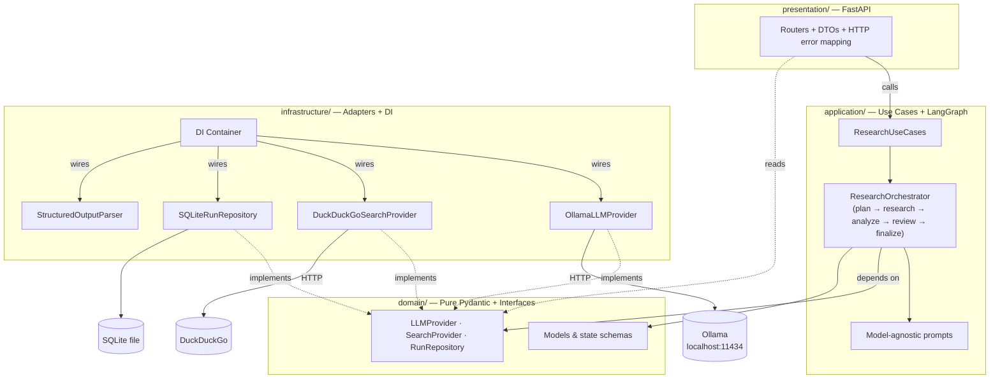

# Multi-Agent Research & Workflow Orchestrator

A clean, modular, end-to-end research workflow built with **FastAPI**, **LangGraph**, **React**, a local **Ollama** model, and free **DuckDuckGo** web search. It is fully model-agnostic and costs nothing to run: swap `qwen2.5` for `gemma2`, `deepseek-r1`, `llama3.1`, or any Ollama model with a single `.env` change — no code changes required.

---

## Features

- **Four collaborating agents** orchestrated with LangGraph: Planner, Researcher, Analyst, and Reviewer/Critic, plus a final Editor synthesis step.
- **Conditional routing with a hard loop guard**: a `revise` verdict loops back to research only while `iteration_count < max_iterations` (default 2), so infinite loops are impossible.
- **Grounded results**: real web search results (URL, title, snippet) feed the analyst and appear as clickable citations in the final Markdown report.
- **Model-agnostic structured output**: a resilient parser strips `<think>...</think>` reasoning blocks and markdown code fences before Pydantic validation, with retry/fallback — no hardcoded prompt templates or stop tokens.
- **Clean Architecture**: strict layer separation and dependency inversion. Adapters are swappable without touching domain or application code.
- **Offline-friendly**: Ollama offline → empty model list and clear errors; DuckDuckGo failure → empty results fallback. All tests run offline with mocked providers.
- **Responsive React UI**: configure model/iterations, watch step-by-step agent execution, read reviewer feedback, and browse the final report with clickable source links.

---

## Architecture



### Clean Architecture layer breakdown

| Layer | Directory | Responsibility | Allowed dependencies |
| --- | --- | --- | --- |
| **Domain** | `backend/domain/` | Pure Pydantic models, state schemas, abstract `Protocol` interfaces | Pydantic only — **no** frameworks or vendors |
| **Application** | `backend/application/` | Use cases, LangGraph orchestration, agent nodes, prompts | `domain/` only — **never** Ollama/DuckDuckGo/SQLite |
| **Infrastructure** | `backend/infrastructure/` | Concrete adapters, resilient parser, config, DI wiring | Implements `domain/` interfaces |
| **Presentation** | `backend/presentation/` | FastAPI routers, request/response DTOs, HTTP error mapping | Calls **application** use cases only |

Dependencies always point inward. Swapping **Ollama → OpenAI/Gemini** or **DuckDuckGo → Tavily** requires implementing the relevant protocol in `infrastructure/` and changing one line in `infrastructure/di.py` — `domain/` and `application/` remain untouched.

### Project structure

```
.
├── backend/
│   ├── domain/
│   │   ├── models.py               # Pydantic models + RunState
│   │   └── interfaces.py           # LLMProvider, SearchProvider, RunRepository
│   ├── application/
│   │   ├── orchestrator.py         # LangGraph graph, agent nodes, routing + loop guard
│   │   ├── prompts.py              # Model-agnostic prompt templates
│   │   └── use_cases.py            # ResearchUseCases
│   ├── infrastructure/
│   │   ├── config.py               # .env settings
│   │   ├── parser.py               # Resilient structured-output parser
│   │   ├── di.py                   # Dependency injection wiring
│   │   ├── llm/ollama_provider.py
│   │   ├── search/duckduckgo_provider.py
│   │   └── repository/sqlite_repository.py
│   ├── presentation/
│   │   ├── api.py                  # /api routers
│   │   └── dto.py                  # Request/response DTOs
│   ├── main.py                     # FastAPI app + /health
│   ├── requirements.txt
│   └── .env.example
├── frontend/
│   ├── src/App.jsx
│   ├── src/components/RunTimeline.jsx
│   ├── src/components/ReportView.jsx
│   ├── src/index.css
│   ├── vite.config.js              # Proxies /api → localhost:8000
│   └── package.json
├── tests/
│   ├── conftest.py                 # Offline fake providers
│   ├── test_parser.py              # Parser edge cases (<think>, fences, validation)
│   ├── test_graph.py               # State transitions, routing, loop guard
│   └── test_api.py                 # FastAPI endpoints with mocked providers
├── .env.example
├── pytest.ini
└── README.md
```

---

## Agent workflow

1. **Planner** decomposes the topic into 3–4 sub-questions and search queries.
2. **Researcher** queries the search provider for each sub-question, collecting real sources (title, URL, snippet).
3. **Analyst** synthesizes findings into structured insights, takeaways, comparisons, and knowledge gaps.
4. **Reviewer/Critic** grades the draft on completeness, structure, grounding, and citations, returning a structured `pass`/`revise` decision with actionable feedback.
5. **Conditional routing**: `revise` + `iteration_count < max_iterations` → loop back to Researcher/Analyst; otherwise → Editor. `iteration_count` increments on each revision request, so the loop is strictly capped.
6. **Editor** produces the final Markdown report with an executive summary, key takeaways, and a clickable sources section.

Every node appends an **agent step** to the run state, and the full run (including the reviewer decision) is persisted to SQLite and exposed via the API.

---

## Setup

### Backend

```bash
cd backend
python -m venv .venv
# Windows: .venv\Scripts\activate    |    macOS/Linux: source .venv/bin/activate
pip install -r requirements.txt
cp .env.example .env          # Windows: copy .env.example .env
uvicorn main:app --reload --port 8000
```

Health check: `curl http://localhost:8000/health` → `{"status":"ok"}`
Interactive docs: `http://localhost:8000/docs`

If Ollama is not running, startup still succeeds. `GET /api/models` returns `{"models":[]}` and generation endpoints surface a clear error.

### Frontend

```bash
cd frontend
npm install
npm run dev
```

Open `http://localhost:5173`. The Vite dev server proxies `/api` to `http://localhost:8000`. For production, run `npm run build` and serve `dist/` (and configure your proxy/CORS accordingly).

### Running with any Ollama model

Install Ollama, pull a model, and set `OLLAMA_MODEL` in `backend/.env`:

```bash
ollama pull qwen2.5:7b-instruct-q4_k_m     # default
ollama pull gemma2
ollama pull deepseek-r1
ollama pull llama3.1

# .env — change one line, restart the backend
OLLAMA_MODEL=gemma2
```

You can also override the model per request (UI field or `POST /api/runs` body). No prompt templates, stop tokens, or code need to change — the parser and prompts are model-agnostic. Point at a remote Ollama with `OLLAMA_BASE_URL`.

---

## API reference

| Method | Endpoint | Description |
| --- | --- | --- |
| `POST` | `/api/runs` | Start a run. Body: `{ "topic": "...", "model"?: "...", "max_iterations"?: 2 }` |
| `GET` | `/api/runs/{run_id}` | Inspect status, agent steps, reviewer decision, and final report |
| `GET` | `/api/runs` | List past runs (most recent first) |
| `GET` | `/api/models` | Locally available Ollama models (`[]` if offline) |
| `GET` | `/health` | Liveness probe |

---

## Testing

```bash
# from the repository root
python -m pytest -q
```

16 offline tests cover:
- Parser edge cases: `<think>` tags, fenced JSON, prose-embedded JSON, invalid JSON, missing/invalid fields, `parse_or_none`.
- Graph state transitions and step logging.
- Conditional routing and the `max_iterations` loop guard (including cap enforcement).
- FastAPI endpoints with mocked providers (start, get, list, models, 404 handling).

Tests use fakes from `tests/conftest.py`; no Ollama, DuckDuckGo, or network is required.

---

## Swapping adapters (example)

To use **Tavily** instead of DuckDuckGo:
1. Create `infrastructure/search/tavily_provider.py` implementing `SearchProvider.search`.
2. In `infrastructure/di.py`, replace `DuckDuckGoSearchProvider(...)` with `TavilySearchProvider(...)`.

Nothing in `domain/` or `application/` changes. The same applies to replacing `OllamaLLMProvider` with an OpenAI/Gemini adapter.

---

## Known limitations

- **Local model quality**: small local models may produce shallow analysis or ignore JSON instructions. The parser retries and asks for corrected JSON, but very weak models can still exhaust retries (the run is marked `failed`). Use a sufficiently capable model (7B+ recommended).
- **Synchronous runs**: `POST /api/runs` executes the whole workflow before responding; long research topics can take a minute or more. There is no background job queue or progress streaming (the UI polls defensively).
- **Search dependency**: DuckDuckGo HTML results can be rate-limited or blocked; the provider degrades to empty results rather than failing, which reduces grounding quality.
- **No conversation memory**: each run is independent; there is no multi-turn refinement beyond the reviewer loop.
- **SQLite**: suitable for local/single-process use. For multi-worker deployments, replace `SQLiteRunRepository` with a networked database adapter.
- **Citation fidelity**: the Editor model generates inline citation markers; they reflect the sources given to it but are not verified against the exact snippet text.
